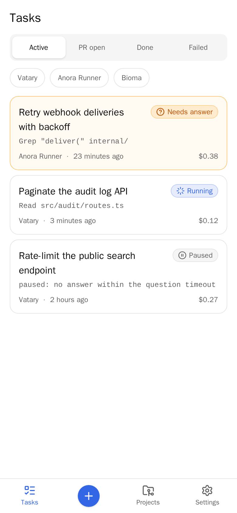
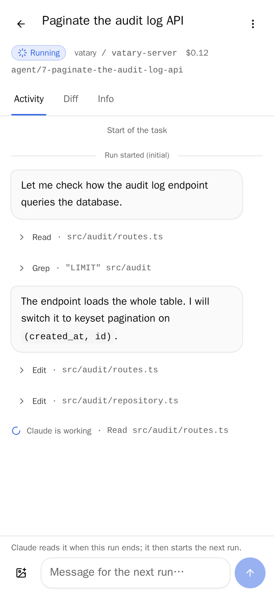
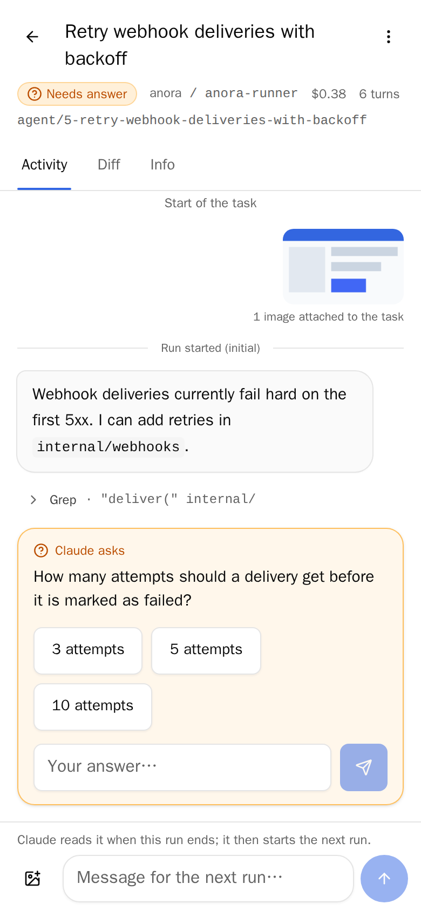
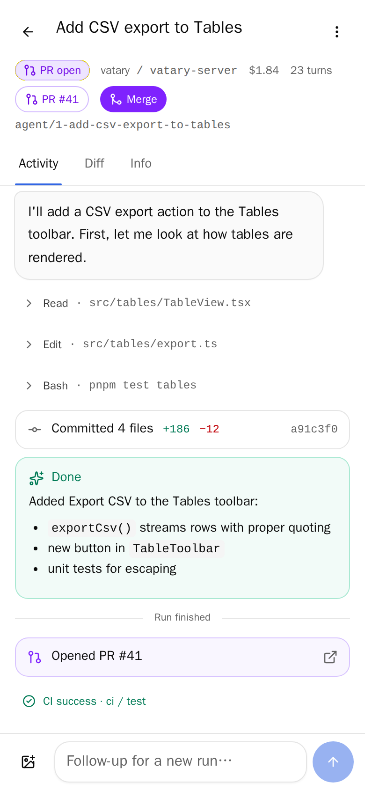
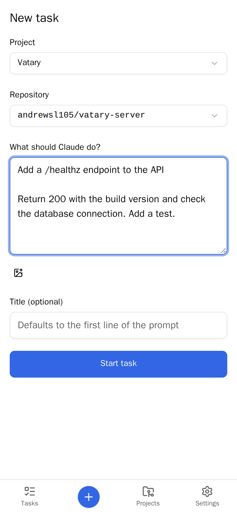
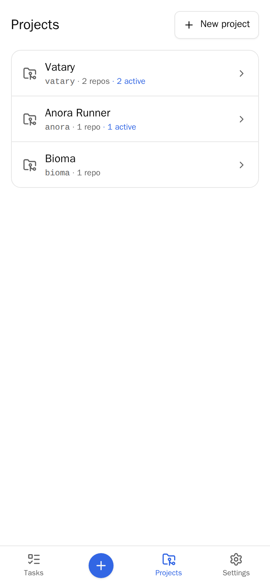
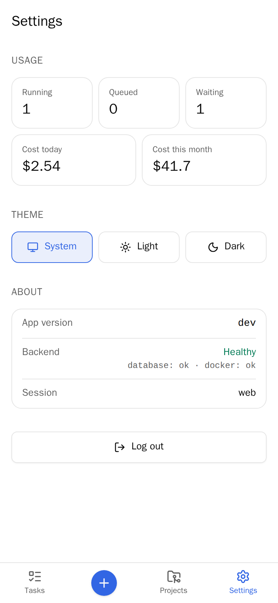
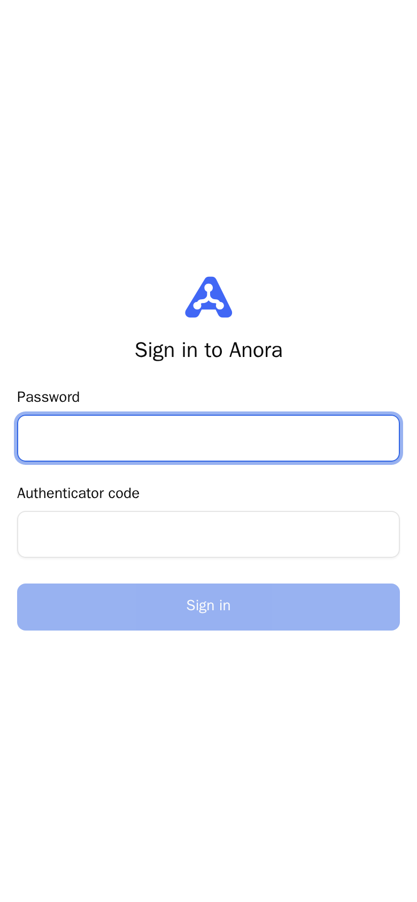
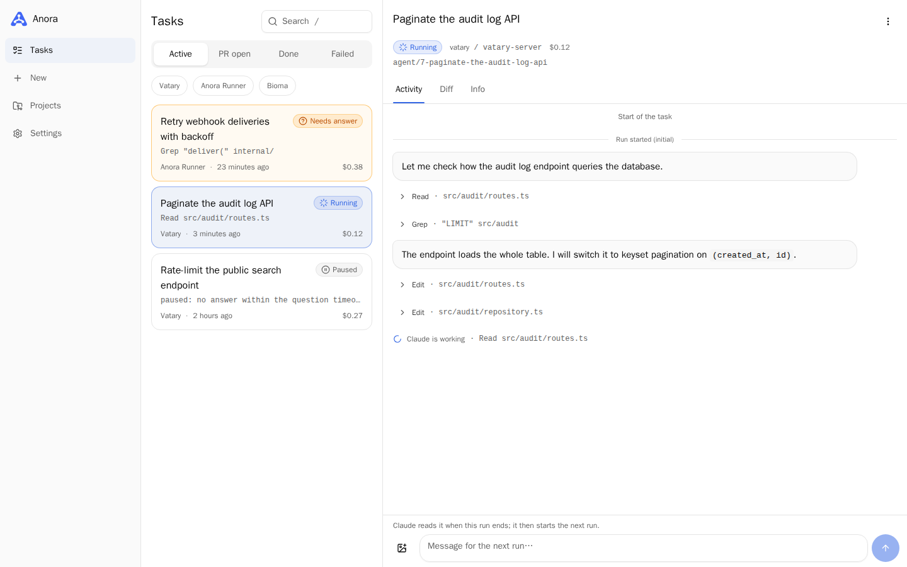

# Fleetpocket

Run Claude Code against your GitHub repositories from your phone, in isolated containers, and get a pull request back.

[](https://github.com/AndrewSl105/anora-mono/actions/workflows/ci.yml)
[](https://github.com/AndrewSl105/anora-mono/actions/workflows/release.yml)
[](LICENSE)
[](server/go.mod)
[](.github/workflows/ci.yml)

## What it is

Anora is a self-hosted, single-owner service for running a coding agent against your own repositories when you are away from the keyboard. You describe a change in Telegram. The server starts a Claude Code session in a fresh Docker container that holds only a checkout of the repository, streams its progress to you, passes on any question it asks, and opens a pull request when it is done. You use it through a Telegram bot or through the web client, which also works as a Telegram Mini App. The agent never gets a GitHub token or Docker access: the server holds every credential and performs every side effect.

## Screenshots

<!-- DEMO_VIDEO_URL -->

<p align="center"></p>

<table>
  <tr>
    <td><picture><source media="(prefers-color-scheme: dark)" srcset="docs/screenshots/tasks-phone-dark.png"></picture></td>
    <td><picture><source media="(prefers-color-scheme: dark)" srcset="docs/screenshots/task-running-phone-dark.png"></picture></td>
    <td><picture><source media="(prefers-color-scheme: dark)" srcset="docs/screenshots/task-question-phone-dark.png"></picture></td>
    <td><picture><source media="(prefers-color-scheme: dark)" srcset="docs/screenshots/task-pr-phone-dark.png"></picture></td>
  </tr>
  <tr>
    <td><picture><source media="(prefers-color-scheme: dark)" srcset="docs/screenshots/new-task-phone-dark.png"></picture></td>
    <td><picture><source media="(prefers-color-scheme: dark)" srcset="docs/screenshots/projects-phone-dark.png"></picture></td>
    <td><picture><source media="(prefers-color-scheme: dark)" srcset="docs/screenshots/settings-phone-dark.png"></picture></td>
    <td><picture><source media="(prefers-color-scheme: dark)" srcset="docs/screenshots/login-phone-dark.png"></picture></td>
  </tr>
</table>

<picture><source media="(prefers-color-scheme: dark)" srcset="docs/screenshots/task-running-desktop-dark.png"></picture>

The screenshots switch between light and dark to match your GitHub theme. `make screenshots` generates them from the mock backend ([web/e2e/screenshots](web/e2e/screenshots/screenshots.spec.ts)).

## Built with itself

Anora opened the most recent pull requests in this repository from the owner's Telegram messages. Each one started as a task. The agent worked on an `agent/<task>-<slug>` branch and committed as `anora[bot]`, and the owner reviewed and merged the result.

- [#1](https://github.com/AndrewSl105/anora-mono/pull/1): small UI fixes on the settings page
- [#2](https://github.com/AndrewSl105/anora-mono/pull/2): design document for multi-provider agents ([docs/design/multi-provider-agents.md](docs/design/multi-provider-agents.md))
- [#3](https://github.com/AndrewSl105/anora-mono/pull/3): Telegram notification when Claude asks a question, with an integration test
- [#4](https://github.com/AndrewSl105/anora-mono/pull/4): records the decision to stop running CI on pull requests
- [#5](https://github.com/AndrewSl105/anora-mono/pull/5): merge a task's pull request from the web client
- [#6](https://github.com/AndrewSl105/anora-mono/pull/6): agent policy for claude.ai artifact links, with tests

## Architecture

```
Telegram bot ─┐                        ┌─ GitHub (clone, push, PR, webhooks)
Web/Mini App ─┼─► server (Go) ─────────┤
 (web/)       │   API · bot · scheduler └─ docker-proxy ─► per task: network anora-task-N
              │   holds every credential                    ├─ agent (Claude Code, /workspace)
              └── postgres                                  └─ postgres / redis sidecars
```

The server holds every credential and performs every side effect. An agent sees only its workspace folder and a prompt. It gets no GitHub token, no Docker access and no host network.

How a task moves through the system:

1. **Task.** The owner sends a message to the bot or submits the web form. The server stores the task in Postgres and queues it.
2. **Container.** The scheduler clones the repository using a GitHub App installation token. It then creates a network for the task, with optional Postgres and Redis sidecars, and starts the agent container through docker-socket-proxy.
3. **Events.** The agent runs Claude Code and writes each event as a line of JSON on stdout ([protocol](docs/PROTOCOL.md)), and also appends it to `.anora/events.jsonl` in the workspace. The server stores the events and streams them to the web client over WebSocket. Questions from Claude show up as answer buttons in the web client and in Telegram.
4. **PR.** When the run ends, the server checks the diff, including a gitleaks scan for secrets. It then pushes the branch and opens a pull request as the GitHub App.
5. **CI checks.** GitHub webhooks for check suites and workflow runs update the task's CI status.
6. **Notification.** Telegram receives the PR link and the CI result. The owner can reply to the task message with a follow-up, which starts the next run on the same branch.

## Engineering highlights

- **Security model.** The agent container gets no GitHub token, no Docker socket and no host network. It runs on a network of its own, with every Linux capability dropped and `no-new-privileges` set ([runnermgr/docker.go](server/internal/runnermgr/docker.go)). The server talks to Docker only through `tecnativa/docker-socket-proxy`, on a network with no egress ([docker-compose.deploy.yml](deploy/docker-compose.deploy.yml)). Cloning, pushing and opening PRs use GitHub App installation tokens that never leave the server. The requirements are in [SPEC-server sections 3 and 5](docs/SPEC-server.md#3-architecture-and-task-lifecycle).
- **Restart-safe scheduler.** When the server starts, it does the following ([scheduler/reconcile.go](server/internal/scheduler/reconcile.go), [OPERATIONS.md](docs/OPERATIONS.md)):
  - re-attaches to running agents and replays missed events from `events.jsonl`;
  - applies exits that happened while it was down;
  - re-queues interrupted preparation and retries interrupted pushes;
  - removes orphaned containers and networks.
- **One API contract.** [docs/openapi.yaml](docs/openapi.yaml) is the source of truth. The web client's TypeScript types are generated from it (`make gen-api`), a server test reads the same file, and CI fails if the generated `schema.ts` is stale ([ci.yml](.github/workflows/ci.yml)).
- **Server ↔ agent protocol.** The server and the agent talk in JSON lines over the container's stdin/stdout. Every event carries a sequence number, so missed events can be replayed ([docs/PROTOCOL.md](docs/PROTOCOL.md); source of truth [agent/src/protocol.ts](agent/src/protocol.ts), Go mirror [runnermgr/protocol.go](server/internal/runnermgr/protocol.go)).
- **Auth.** The browser signs in with a bcrypt-hashed password plus a TOTP code, and the Mini App with signed Telegram `initData`. Sign-in is rate-limited, and every request that changes state must carry a CSRF header ([internal/auth](server/internal/auth), [api/middleware.go](server/internal/api/middleware.go)).
- **Observability.** Prometheus metrics are served on `/metrics`, reachable only inside the server's network: tasks by status, queue length, run duration, cost, runner exits, and GitHub and Telegram API errors. Logs are JSON from `log/slog`, tagged with task, run and project ([metrics.go](server/internal/metrics/metrics.go), [OPERATIONS.md](docs/OPERATIONS.md)).
- **Testing.**
  - Go integration tests run against a real Postgres and real Docker, using a fake agent image ([scheduler/integration_test.go](server/internal/scheduler/integration_test.go)), plus golangci-lint and gitleaks.
  - The agent has `node:test` unit tests and the web client has Vitest.
  - Playwright smoke tests run against an in-browser MSW backend ([web/src/mocks](web/src/mocks)), and a second suite runs against the real dev stack ([web/e2e](web/e2e)).
- **CI/CD.** CI jobs are path-filtered per part. The release workflow builds only the images whose directories changed, pushes them to GHCR and deploys over SSH with `docker compose up -d` ([release.yml](.github/workflows/release.yml), [DEPLOY.md](docs/DEPLOY.md#cicd)). The web build also has bundle size budgets ([check-size.mjs](web/scripts/check-size.mjs)).

## Tech stack

| Part | Stack |
|---|---|
| Server | Go 1.27, pgx + goose (Postgres), coder/websocket, telego (Telegram Bot API), moby client (Docker), go-github + ghinstallation (GitHub App), pquerna/otp, Prometheus client |
| Agent | TypeScript, Node 24, Claude Agent SDK (`@anthropic-ai/claude-agent-sdk`), zod |
| Web | React 19, Vite, Tailwind CSS 4, shadcn/ui (Radix), TanStack Query, openapi-fetch + openapi-typescript, MSW, Vitest, Playwright |
| Infra | Docker Compose, Caddy (TLS), Postgres 17, docker-socket-proxy, GitHub Actions, GHCR |

## Repository layout

```
server/   Go service: REST + WebSocket API, Telegram bot, scheduler, Docker and GitHub   (server/README.md)
agent/    TypeScript agent (Claude Agent SDK) that runs inside each task container      (docs/PROTOCOL.md)
web/      React web client and Telegram Mini App, static files served by nginx          (web/README.md)
deploy/   docker-compose.deploy.yml + Caddyfile (server), docker-compose.dev.yml (local), .env.example
docs/     SPEC-server.md, SPEC-web.md, API.md, PROTOCOL.md, openapi.yaml, DECISIONS.md
```

Images: `ghcr.io/andrewsl105/anora-server`, `anora-agent`, `anora-web`.

## Run locally in 2 minutes

To run the web client against an in-browser mock backend (no Docker, no Go):

```sh
cd web && npm ci && npm run dev:mock
```

Open `http://localhost:5173` and sign in with password `anora` and code `123456`. One simulated task runs live and another waits for an answer.

To run the full stack (server, Postgres, docker-socket-proxy and a fake agent that needs no Claude account):

```sh
make deps && make dev-setup   # once: prints a password hash and a TOTP secret for deploy/.env.dev
make dev
```

See [docs/DEVELOPMENT.md](docs/DEVELOPMENT.md) for details.

## Documentation

- [Development](docs/DEVELOPMENT.md): local dev stack, tests, lint, codegen, screenshots.
- [Deployment](docs/DEPLOY.md): server setup (steps 1–10) and CI/CD.
- [Operations](docs/OPERATIONS.md): health, metrics, logs, retention, restart safety.
- [API](docs/API.md) and the [OpenAPI contract](docs/openapi.yaml).
- [Server ↔ agent protocol](docs/PROTOCOL.md).
- Specs: [server and agent](docs/SPEC-server.md), [web](docs/SPEC-web.md). Deviations from them: [DECISIONS.md](docs/DECISIONS.md).
- Part READMEs: [server](server/README.md), [web](web/README.md).

## License

[MIT](LICENSE)
